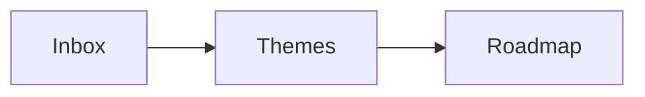

# Demo content

A believable company's documentation, for seeding a local instance with `pnpm seed:demo`. It can be
blown away (`pnpm db:reset`) and recreated at any time: nothing else depends on it.

## The premise

**Acme Software** is a 240-person B2B software company that makes two products:

- **Tidepool**, a web app where product teams collect customer feedback (from support tickets,
  interviews, an in-app widget and CSV imports), cluster it into themes, and publish a public
  roadmap. TypeScript and Node, PostgreSQL and Redis, React on the web, Kubernetes on AWS (primary
  `us-east-1`, failover `eu-west-1`). Customers range from startups to hospitals and retailers.
- **Skiff**, its iOS and Android companion app (React Native) for capturing feedback in the field:
  quick notes, voice notes that become transcripts, and offline work that syncs later.

People (roles are enough; a few named for texture, addresses `first@acme.example`): Priya Nair, VP
Product. Marcus Lee, engineering manager for the platform team. Sofia Alvarez, head of design. Tom
Becker, support lead. Aisha Khan, security lead. Jonas Weber, staff engineer on mobile. Dana
Okafor, people operations. Ravi Menon, head of marketing.

"Today" is Monday 12 October 2026. Releases are dated by month (`2026.9`, `2026.10`). Customers
named in documents: Harbourview Health, Northwind Retail, Lantern Logistics, Pinecrest Bank,
Oakline Studios (all fictional).

## One document

A directory under `content/<workspace-slug>/<document-slug>/`:

```
meta.json    what the document is
1.md         the first published revision (the body only, which starts with its own "# Title")
2.md         the next revision, when it has one (each file is the WHOLE body at that revision)
draft.md     optional: the draft, which is ahead of the last revision (status "draft-ahead")
             or, for status "draft", the only content: a document never published
```

`meta.json`:

```json
{
  "collection": "Strategy",
  "title": "Product vision 2027",
  "type": "design",
  "owners": ["priya@acme.example"],
  "tags": ["vision", "tidepool"],
  "review": "180d",
  "status": "published",
  "notes": ["First draft", "Added the pricing principles after the leadership offsite"],
  "frontMatter": {}
}
```

- `status`: `published` (revisions only), `draft-ahead` (revisions, and a `draft.md` of unpublished
  changes), or `draft` (no revisions, only `draft.md`).
- `notes`: one change note per revision, oldest first; the same count as the `N.md` files.
- `type`: free text. Use `design`, `runbook`, `adr`, `spec`, `guide`, `reference`, `policy`,
  `postmortem`, `playbook`, `meeting`, `research`, `article` or `template`.
- `review`: optional, how often it should be reviewed: `90d`, `180d`, `1y`, `6m`.
- `frontMatter`: extra front matter, merged in. Only a template uses it (see below).
- Most documents have 1 or 2 revisions; a few have 3 or 4. Later revisions are the earlier body
  edited the way a person would: a section added, numbers updated, a decision recorded, a typo or
  two fixed. They are never rewritten wholesale.

## Linking between documents

Write `[the failover runbook](doc:Multi-region failover)`: a link whose target is `doc:` and the
exact title of another demo document. The seed turns it into the real address. Titles are unique
across the whole demo. Do not link to a title that is not in the list you were given.

## The Markdown, and what Quill adds

Everything is CommonMark plus GFM (tables, task lists, strikethrough, footnotes), plus these. Use
them where they belong in the document, not for show; but a demo should show them, so use each kind
a few times across the documents you write.

**Callouts**: GitHub style, or the directive. Types: `note`, `info`, `tip`, `important`,
`warning`, `caution`.

```markdown
> [!WARNING]
> Failing over drops in-flight webhooks.

:::callout[Before you begin]{type=tip}
A title is optional. A callout can hold several blocks.
:::
```

**Details**, and **accordions** (details sharing a `name` open one at a time):

```markdown
:::details[Why is the first build slow?]
Any blocks inside.
:::

:::details[Read this before upgrading]{open type=warning}
Open by default, drawn as a warning.
:::

::::accordion{name=faq}
:::details[How do I invite someone?]
From the workspace's settings.
:::
:::details[How do I leave?]
From your profile.
:::
::::
```

**Tables**: a plain GFM table is wide, scrollable, sortable, with numbers right-aligned. For a
caption or options, wrap it. Options: `width` (`content`, `wide`, `full` or `70%`),
`columns="2fr 3fr 1fr"`, `headers=row|column|both`, `footer=1`, `responsive=stack|scroll`,
`sort=off`, `caption=bottom`.

```markdown
:::table[Latency budgets]{width=70% footer=1 caption=bottom}
| Service | What it does | Latency |
| :------ | :----------- | ------: |
| Gateway | Routes every request | 12 ms |
| Total   |              | 12 ms |
:::
```

**Widths**: `:::wide` and `:::full` wrap a block that should break out of the reading column (a big
table, a diagram). Nesting needs more colons on the outer one: `::::wide` around `:::figure`.

**Code**: fenced, with a language and an optional title; and **code groups** that become tabs.

````markdown
```ts title="src/client.ts"
const feedback = await tidepool.feedback.list({ limit: 50 })
```

:::code-group
```sh [npm]
npm install @tidepool/sdk
```
```sh [pnpm]
pnpm add @tidepool/sdk
```
:::
````

Languages in use: `ts`, `js`, `py`, `sql`, `bash`, `json`, `yaml`, `diff`, `swift`, `kotlin`.

**Diagrams**: Mermaid, in a `:::figure` so it has a caption (the paragraph after the diagram). Give
each `accTitle` and `accDescr`.

````markdown
::::wide
:::figure



Feedback becomes a roadmap item only through a theme.
:::
::::
````

`sequenceDiagram`, `stateDiagram-v2`, `erDiagram` and `gantt` also work.

**Cards**: each heading inside starts a card. `variant=ruled` for short principles, `panels` (the
default) for richer cards.

```markdown
:::cards{variant=ruled}
### Capture everything

Nothing a customer says is lost.

### Decide in public

The roadmap is a promise.
:::
```

**Badges** and **labels**: `:ok[Built]` `:warn[Partial]` `:bad[Failed]` `:accent[New]` `:plan[Planned]`,
or `:badge[Beta]{tone=warning}` (tones: neutral, accent, success, warning, danger). Labels are the
organisation's own coloured pills; these four exist: `:tidepool[Tidepool]`, `:skiff[Skiff]`,
`:api[API]`, `:security[Security]`.

**Small things**: emoji shortcodes (`:rocket:`, `:white_check_mark:`, `:warning:`, `:bulb:`), keys
`:kbd[Ctrl+K]`, small print `:small[Last verified 3 October 2026.]`.

**Navigation**: `::toc{min=2 max=3}` (a contents list, at the top of a long document),
`::children{depth=2}` (the pages beneath this one: only for an index page).

**Presenter notes**: `:::notes` ... `:::` (shown only to the presenter). Use in documents meant to
be presented (a strategy review, a launch plan, a design critique).

**Not available, do not use**: images (there are no files to point at), math, raw HTML (apart from
the exact `<details>` form), MDX, `::figma`, Obsidian callout folds, custom emoji.

## Templates

A template is a document with `"type": "template"` and, in `meta.json`, a `frontMatter` like the one
below. Its body is the starting point for new documents: it uses `{{ answers.<id> }}`,
`:placeholder[...]`, `:::guidance`, `:::optional{title="..."}`, `:::when{question=<id>}` and
`:::repeat{title="..."}`. Every section named in `sections` must appear as a heading in the body,
every question needs a `default` or `"optional": true`, and every `when` names a declared question.

```json
{
  "type": "template",
  "template": {
    "name": "Postmortem",
    "category": "Engineering",
    "version": 1,
    "questions": [
      { "id": "incidentTitle", "label": "Short title", "type": "text", "default": "Untitled incident" },
      { "id": "customerImpact", "label": "Were customers affected?", "type": "boolean", "default": true }
    ],
    "sections": [
      { "heading": "Summary", "required": true },
      { "heading": "Customer impact", "when": "customerImpact", "optional": true }
    ]
  }
}
```

Question types: `text`, `boolean`, `choice` (with `options`), `date`, `document`, `user`.

## Length and variety

A real documentation set has all sizes. Roughly: a short article is 120 to 250 words; a normal one
350 to 700; a long design or report 900 to 1,600. Vary them as the document list says. Write like
the author: concrete numbers, names, dates, decisions and trade-offs; never "lorem ipsum", never
"this document describes". Headings are sentence case. Start every body with `# <the title>`.
