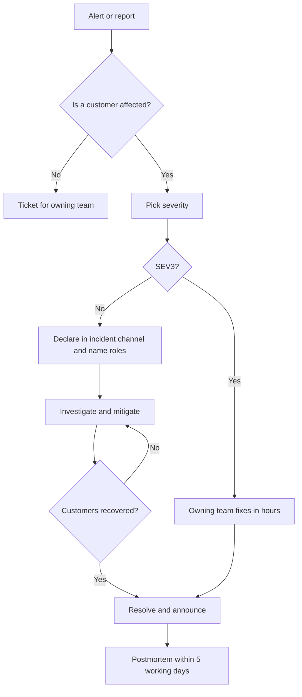

# Incident response process

An incident is anything that is hurting customers, or is about to, that needs more than one person to fix. This is how we run one. It is deliberately short, because nobody reads a long document at 03:00.

## Severity

Pick the severity from the customer's side, and raise it if you are unsure. It can always be lowered later.

| Severity | Meaning | Examples | First response |
| :------- | :------ | :------- | -------------: |
| SEV1 | Tidepool or Skiff is down or losing data for most customers | Region outage; sign-in failing for everyone | 5 min |
| SEV2 | A major feature is broken or badly degraded for many customers | Webhooks delayed; imports failing; one enterprise customer fully blocked | 15 min |
| SEV3 | A minor feature is degraded, or a few customers are affected, and there is a workaround | A single integration failing; slow exports | 1 working day |

## Roles

Name these in `#incident` as soon as a SEV1 or SEV2 is declared. One person can hold two roles in a SEV3, but never the incident commander and the person fixing the problem.

- **Incident commander (IC).** Runs the incident: sets the severity, assigns work, decides when to escalate and when it is over. The IC does not debug.
- **Operations lead.** Leads the technical investigation and does the changes.
- **Communications lead.** Writes the status page updates and talks to Support. Tom Becker's team provides this role during working hours.
- **Scribe.** Keeps the timeline in the incident channel: what was seen, what was tried, at what time.

## How an incident runs

::::wide
:::figure

Mitigate first, find the cause second. A rollback that stops the bleeding beats a clever fix.
:::
::::

## Communication

- The IC posts a summary in `#incident` every 30 minutes, even if it is "no change".
- For SEV1 and SEV2, the Communications lead updates the status page within 15 minutes of declaring, and again every 30 minutes.
- Customers with a named contact, such as Harbourview Health and Pinecrest Bank, are told by their account owner, not by the status page alone.
- Say what customers see and what we are doing. Do not guess at a cause or a time to fix.

## After the incident

Every SEV1 and SEV2 gets a blameless postmortem within five working days, written from the [Postmortem](doc:Postmortem) template. It is reviewed in the Thursday engineering sync. Action items get an owner and a date, and are checked again after 30 days.
