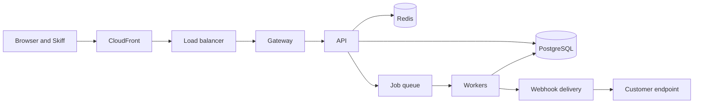

# Platform overview

Tidepool and the backend for Skiff run as one set of services on Kubernetes in AWS. This page is the map: what runs where, who owns it, and which pieces we keep deliberately boring. Detail lives in the runbooks and standards linked from each section.

## Shape of the system

Every request from the web app, the public roadmap, the feedback widget and Skiff enters through CloudFront, passes the application load balancer and lands on the gateway. The gateway authenticates the caller, applies rate limits and forwards to the API. Anything slow (CSV imports, theme clustering, webhook delivery, voice transcription) is put on a Redis-backed queue and handled by workers.

::::wide
:::figure

Fast work stays on the request path; everything else crosses the queue.
:::
::::

## Regions

Production lives in `us-east-1`, the only region that takes writes. `eu-west-1` is a warm standby: a smaller EKS cluster, a PostgreSQL read replica and an empty Redis cluster. We chose warm standby over active-active because a single writer keeps the data model simple, and our larger contracts (Pinecrest Bank, Harbourview Health) ask for a recovery time rather than zero downtime. The recovery time objective is 45 minutes and the recovery point objective is 5 minutes. How to cut over is in [Multi-region failover](doc:Multi-region failover).

## Services

:::wide
| Service | Runtime | Owner | Replicas in us-east-1 | Notes |
| :------ | :------ | :---- | --------------------: | :---- |
| gateway | Node 24, Fastify | Platform | 8  | Authentication, rate limits, request IDs |
| api | Node 24, Fastify | Platform | 18 | Stateless; one deploy unit for web and Skiff |
| worker | Node 24, BullMQ | Platform | 12 | Imports, clustering, email, webhook jobs |
| webhooks | Node 24 | Platform | 4 | Signs and delivers customer webhooks, retries with backoff |
| web | React, static on S3 | Web | n/a | Served through CloudFront, 5-minute edge cache on HTML |
| public-site | Node 24, server-rendered | Web | 3 | Public roadmaps and the feedback widget script |
:::

Replica counts are the steady-state figures at the time of writing; the horizontal pod autoscaler moves `api` between 12 and 30 and `worker` between 8 and 24. Sizing history is in [Capacity planning](doc:Capacity planning).

## Data stores

- **PostgreSQL 16** on RDS, Multi-AZ, `db.r6g.4xlarge` (16 vCPU, 128 GiB), about 1.7 TB. One database, one schema; every row carries a `workspace_id` and row-level security enforces it, so a query bug cannot return another customer's feedback.
- **Redis 7** on ElastiCache, three shards with one replica each. It holds the BullMQ queues, rate limit counters and short-lived caches. We treat it as lossy: nothing in Redis is the only copy of anything.
- **S3** holds CSV uploads and Skiff audio. Raw audio is deleted after 90 days; transcripts stay in PostgreSQL.

## Delivery

GitHub Actions builds an image per commit and pushes it to ECR. Argo CD syncs the same commit to both regions, and Argo Rollouts sends 10% of traffic to the new version for 15 minutes before promoting it. We deploy about 14 times a day. Database migrations run before the rollout and follow our database migrations policy, which is why every schema change is backwards compatible with the previous release.

## Environments

| Environment | Where | Scale | Data |
| :---------- | :---- | :---- | :--- |
| dev | Shared cluster, one namespace per branch | Single replicas | Synthetic |
| staging | `us-east-1`, own cluster | One eighth of production | Anonymised nightly copy |
| production | `us-east-1` plus `eu-west-1` standby | See above | Customer data |

## What we keep boring

- One language on the backend. TypeScript and Node, so any engineer on the platform team can read any service.
- One database and one queue technology. We have resisted Kafka twice; at 1,350 requests per second at peak, BullMQ on Redis is enough.
- All AWS resources are Terraform. A resource created in the console is deleted at the next weekly drift check.
- No service mesh. Mutual TLS and retries are handled by the gateway and a small shared client library.
