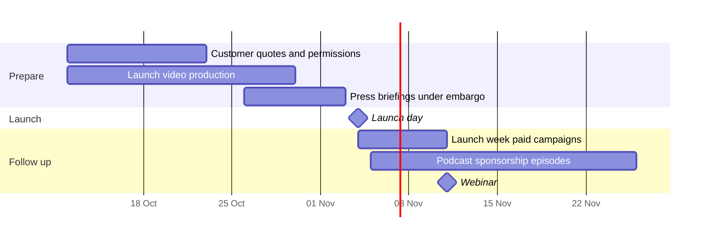

# Skiff 2.0 launch plan

::toc{min=2 max=2}

## Summary

Skiff 2.0 ships on **Wednesday 4 November 2026** to iOS and Android. It brings the two things customers have asked for most: live transcripts while you record a voice note, and a redesigned capture screen that gets from opening the app to recording in one tap. This plan covers the weeks around the launch, from 12 October to 26 November. Ravi Menon owns the plan, Priya Nair owns the product narrative and Jonas Weber signs off the release build.

:::notes
Open with the customer, not the feature: Harbourview Health's ward staff stopped writing feedback in notebooks. Then show the capture screen in 20 seconds. Save the budget until the end.
:::

## Goals

Skiff has about 9,400 weekly active users today. The launch is judged on adoption and on pipeline, not on impressions.

:::table[Launch goals]{width=wide}
| Goal | Baseline | Target | Measured by |
| :--- | -------: | -----: | :---------- |
| Weekly active Skiff users on 2.0 within 14 days | 0 | 2,350 (25%) | In-app version analytics |
| New Skiff installs from launch campaigns in 14 days | n/a | 1,000 | App Store and Play Console attribution |
| Webinar registrations | n/a | 300 | Webinar platform |
| Trade-press stories at launch | 0 | 2 | Press tracker |
| Tidepool trials started from Skiff pages | 40 a month | 70 a month | Product analytics |
:::

## Audiences

- **Existing Skiff users** (about 9,400 a week): they hear first, by in-app message and email on launch morning.
- **Tidepool admins who have not rolled Skiff out**: usually a head of product or support lead who does not know their field teams can capture feedback on a phone.
- **Researchers and customer success managers**: they interview people all day and are the best fit for voice notes.

## Message pillars

:::cards{variant=ruled}
### See your words as you speak

Live transcripts appear while you record, and you can correct a mistake before you save.

### One tap to capture

The redesigned capture screen opens ready to record and remembers whether you last wrote or spoke.

### Still works offline

Notes and recordings are kept on the phone and sync later. Live transcripts need a connection; offline recordings are transcribed after sync.
:::

The proof point is Harbourview Health, whose triage time fell by 60% (see the [case study](doc:Case study: Harbourview Health)). Copy follows [Brand voice and tone](doc:Brand voice and tone).

## What we will not say

We will not claim perfect transcription, we will not compare Skiff with named competitors, and we will not mention features still on the roadmap. Customers read launch copy literally, and support has to answer for every sentence we publish. If a claim cannot be demonstrated in the app on launch morning, it comes out of the copy.

## Timeline

::::wide
:::figure

Everything before 4 November is preparation under embargo; paid campaigns start on launch day and the podcast episodes run through November.
:::
::::

## Channels and budget

:::table[Budget by channel (USD)]{width=wide footer=1 columns="3fr 2fr 2fr 1fr"}
| Channel | Owner | Dates | Budget |
| :------ | :---- | :---- | -----: |
| LinkedIn and Reddit paid campaigns | Growth marketer | 4 to 25 Nov | 18,000 |
| Launch video (60 seconds) | Content lead | 12 to 30 Oct | 9,500 |
| Podcast sponsorship (3 episodes of The Roadmap Podcast) | Growth marketer | 5 to 26 Nov | 8,000 |
| Webinar: Feedback from the field | Content lead | 11 Nov | 4,500 |
| Product Hunt and community | Community manager | 4 Nov | 2,000 |
| Lifecycle email | Lifecycle marketer | 4 and 11 Nov | 1,500 |
| Customer thank-you gifts | Ravi Menon | Nov | 3,000 |
| Contingency | Ravi Menon | n/a | 5,000 |
| Total | | | 51,500 |
:::

## Launch day

All times are Eastern. Jonas Weber is the single voice on whether the build is healthy.

1. 06:00: staged rollout reaches 100% on both stores. Jonas checks that 2.0 is live and the crash-free session rate is above 99.5%.
2. 08:30: support huddle with Tom Becker's team; help articles go live.
3. 09:00: the embargo lifts. Blog post, press release and release notes publish together.
4. 09:15: email to the 31,000 Tidepool contacts who opted in, and the in-app message to Skiff users.
5. 09:30: LinkedIn, X and community posts; paid campaigns switch on.
6. 14:00: first read of install and adoption numbers, shared in the launch channel.

## Who does what

| Area | Owner | Needs from others |
| :--- | :---- | :---------------- |
| Positioning and messaging | Priya Nair | Sign-off by 16 Oct |
| Release build and store listings | Jonas Weber | Final build by 28 Oct |
| Screens and launch video visuals | Sofia Alvarez | Capture screen frames by 19 Oct |
| Support readiness | Tom Becker | Macros and help articles by 30 Oct |
| Press and analyst briefings | Ravi Menon | Embargoed deck by 23 Oct |

## Tasks

- [x] Positioning signed off by Priya Nair
- [x] Harbourview Health agrees to be named and quoted
- [ ] Launch video script approved by 16 October
- [ ] Store listing copy and screenshots handed to Jonas by 21 October
- [ ] Press list of 25 reporters and analysts agreed
- [ ] Webinar speakers confirmed: Priya Nair and a Harbourview Health guest
- [ ] Embargoed press release and FAQ drafted by 23 October
- [ ] Support macros for transcript questions reviewed by Tom Becker
- [ ] Podcast host reads and ad copy approved by 28 October

:::notes
Ask the room who has not seen the capture screen redesign. Offer a walkthrough with Sofia before the briefings start.
:::
