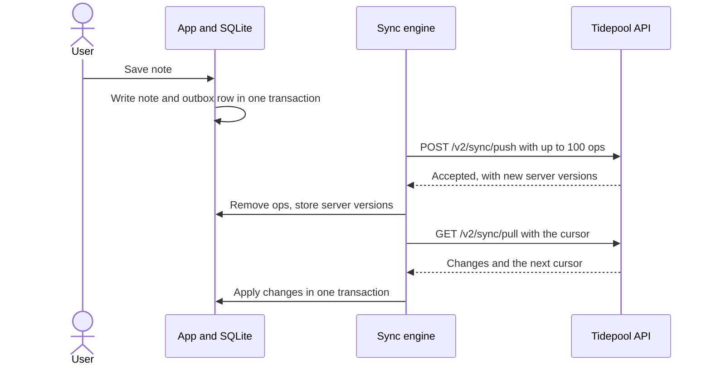

# Offline sync design

Skiff is local-first: every write lands in SQLite on the phone and reaches Tidepool later. Field users at Lantern Logistics regularly work in warehouses with no signal for a whole shift, so "offline" means hours, not seconds. This is how a note travels from a thumb to Tidepool and back, and what happens when two devices disagree. The surrounding layers are in [Skiff app architecture](doc:Skiff app architecture).

## Goals and non-goals

Goals:

- No acknowledged write is ever lost, including across app kills and phone reboots.
- Devices converge: once everyone is online and quiet, every device and the server hold the same notes.
- A sync can be interrupted at any point and resumed without duplicates.
- Sync costs less than 2% of battery on a typical day.

Non-goals: real-time collaboration, offline editing of Tidepool themes, and end-to-end encryption of notes (the phone's storage encryption and TLS in transit are the boundary).

## Data model

Two tables carry the design. The `outbox` is an append-only queue of intentions; the `note` table is the current state.

```sql
create table note (
  id             text primary key,   -- UUIDv7, generated on the device
  workspace_id   text not null,
  body           text not null default '',
  tags           text not null default '[]',
  server_version integer,            -- null until the server has seen it
  deleted_at     integer,            -- tombstone, epoch milliseconds
  updated_at     integer not null
);

create table outbox (
  seq        integer primary key autoincrement,
  op_id      text not null unique,   -- idempotency key
  entity_id  text not null,
  kind       text not null check (kind in ('upsert', 'delete')),
  payload    text not null,
  attempts   integer not null default 0,
  created_at integer not null
);

create table sync_state (key text primary key, value text not null);
```

Ids are UUIDv7 and are created on the device, so a note has its permanent identity before the server has heard of it. That removes the whole class of "temporary id, then rewrite every reference" bugs. `sync_state` holds the pull cursor and nothing else.

## The round trip

::::wide
:::figure



Push always runs before pull, so a device never receives its own change back as news.
:::
::::

The push is the only code that reads the outbox:

```ts title="src/sync/push.ts"
export async function pushOutbox(db: Db, api: SyncApi): Promise<PushResult> {
  const ops = await db.outbox.nextBatch({ limit: 100 })
  if (ops.length === 0) return { sent: 0 }

  const { results } = await api.push({ ops: ops.map(toWireOp) })

  await db.transaction(async (tx) => {
    for (const result of results) {
      if (result.status === 'accepted') {
        await tx.outbox.remove(result.opId)
        await tx.note.setServerVersion(result.entityId, result.serverVersion)
      } else {
        await tx.outbox.park(result.opId, result.reason)
      }
    }
  })
  return { sent: ops.length }
}
```

A parked operation stays in the outbox, is skipped by later pushes and is shown in Settings as "1 note could not be sent". We would rather make a problem visible than retry it forever.

## Conflict rules

When two devices edit the same note while offline, the rule depends on the field.

| Field | Rule | Why |
| :---- | :--- | :-- |
| `body` | Last writer wins, by the device's `updated_at` | Notes are short and rarely edited twice |
| `tags` | Set union of both sides; removals win only if made after the other side's last write | Losing a tag is worse than keeping one too many |
| `deleted_at` | A delete beats an edit made before it | A deleted note should not come back |

## Retry and backoff

Failed pushes retry at 5 s, 30 s, 2 min, 10 min and then hourly, each delay randomised by 20% so a warehouse of handhelds regaining signal together does not stampede the API. Every request carries each op's `op_id`, and the server stores the last 14 days of them, so a retry after a timeout is answered from memory instead of being applied twice.

:::details[What happens if the app is killed mid-sync?]
Nothing is removed from the outbox until the server's response has been received and applied in one transaction. If the process dies after the server accepted but before the transaction committed, the next push resends the same `op_id`s and the server answers "accepted" again with the same versions.
:::

:::details[Why not a CRDT?]
Notes are small documents with a handful of fields, and two people almost never edit the same note offline. A CRDT would add a per-character history to every note and a library we would have to ship in the bundle, to solve a problem we measured at 0.4% of syncs during the pilot. Field rules are cheaper and easy to explain to customers.
:::

## Tombstones

Deleting a note sets `deleted_at` and keeps the row. The server keeps tombstones for 90 days so that a device that has been offline for a month still learns about the delete. A device offline for more than 90 days does a full resync instead of a pull.
