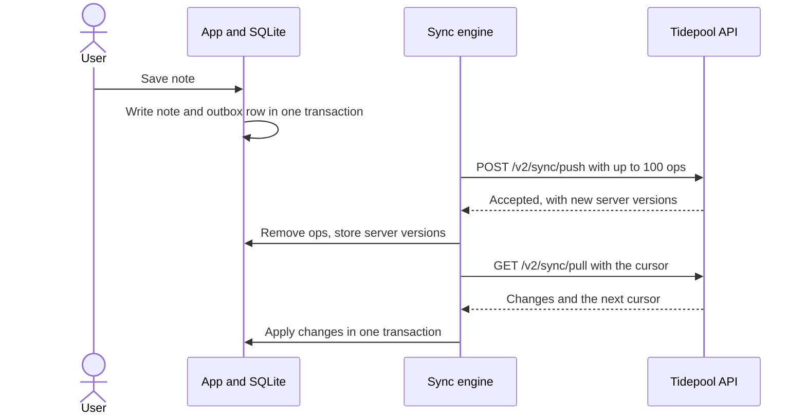

# Offline sync design

Skiff is local-first: every write lands in SQLite on the phone and reaches Tidepool later. Field users at Lantern Logistics regularly work in warehouses with no signal for a whole shift, so "offline" means hours, not seconds. This is how a note, and the voice recording attached to it, travels from a thumb to Tidepool and back, and what happens when two devices disagree. The surrounding layers are in [Skiff app architecture](doc:Skiff app architecture).

## Goals and non-goals

Goals:

- No acknowledged write is ever lost, including across app kills and phone reboots.
- Devices converge: once everyone is online and quiet, every device and the server hold the same notes.
- A sync can be interrupted at any point and resumed without duplicates. An audio upload resumes from the last confirmed chunk.
- Sync costs less than 2% of battery on a typical day (measured: 1.3%, see below).
- The device's clock is never trusted to order anything.

Non-goals: real-time collaboration, offline editing of Tidepool themes, and end-to-end encryption of notes (the phone's storage encryption and TLS in transit are the boundary).

## Data model

Three tables carry the design. The `outbox` is an append-only queue of intentions; `note` and `attachment` are the current state.

```sql
create table note (
  id             text primary key,   -- UUIDv7, generated on the device
  workspace_id   text not null,
  body           text not null default '',
  tags           text not null default '[]',
  server_version integer,            -- null until the server has seen it
  deleted_at     integer,            -- tombstone, epoch milliseconds
  updated_at     integer not null    -- display only, never used for ordering
);

create table attachment (
  id            text primary key,    -- UUIDv7
  note_id       text not null references note (id),
  kind          text not null check (kind in ('audio')),
  chunk_count   integer not null,
  chunks_sent   integer not null default 0,
  upload_id     text,                -- null until the server opened a session
  state         text not null check (state in ('recording', 'pending', 'uploading', 'done'))
);

create table outbox (
  seq          integer primary key autoincrement,
  op_id        text not null unique, -- idempotency key
  entity_id    text not null,
  kind         text not null check (kind in ('upsert', 'delete')),
  base_version integer,              -- the server_version this edit was made on
  payload      text not null,
  attempts     integer not null default 0,
  created_at   integer not null
);

create table sync_state (key text primary key, value text not null);
```

Ids are UUIDv7 and are created on the device, so a note has its permanent identity before the server has heard of it. `sync_state` holds the pull cursor and nothing else.

## The round trip

::::wide
:::figure



Push always runs before pull, so a device never receives its own change back as news.
:::
::::

The push is the only code that reads the outbox. Since 2026.9 it also honours the server's rate limiting instead of falling back to its own schedule:

```ts title="src/sync/push.ts"
export async function pushOutbox(db: Db, api: SyncApi): Promise<PushResult> {
  const ops = await db.outbox.nextBatch({ limit: 100 })
  if (ops.length === 0) return { sent: 0 }

  const response = await api.push({ ops: ops.map(toWireOp) })
  if (response.status === 429) {
    return { sent: 0, retryAfterMs: response.retryAfterSeconds * 1000 }
  }

  await db.transaction(async (tx) => {
    for (const result of response.results) {
      if (result.status === 'accepted') {
        await tx.outbox.remove(result.opId)
        await tx.note.setServerVersion(result.entityId, result.serverVersion)
      } else {
        await tx.outbox.park(result.opId, result.reason)
      }
    }
  })
  return { sent: ops.length }
}
```

A parked operation stays in the outbox, is skipped by later pushes and is shown in Settings as "1 note could not be sent". We would rather make a problem visible than retry it forever.

## Voice recordings

A recording is not part of the push. It would make a 3-minute note a 1.4 MB request that fails whenever the signal does. Instead the note's text syncs first, with an `attachment` row in state `pending`, and the audio follows on its own track:

1. The sync engine asks `POST /v2/uploads` for an `upload_id` and stores it.
2. Chunks (the 10-second files the recorder wrote, about 80 KB each at 64 kbps) go up one at a time with `PUT /v2/uploads/{upload_id}/chunks/{index}`. After each 200, `chunks_sent` is incremented.
3. `POST /v2/uploads/{upload_id}/complete` closes the session. Tidepool then transcribes, and the transcript arrives on the next pull as an update to the note.

An interrupted upload resumes at `chunks_sent`. On iOS the chunks go through a background `URLSession`, so they continue after the app is suspended; on Android a WorkManager job with a network constraint does the same. What the recorder does before this point is described in [Voice capture pipeline](doc:Voice capture pipeline).

## Conflict rules

Every edit carries the `base_version` it was made on. The server compares that with the note's current version: if they match, the edit applies; if not, someone else got there first and the rule depends on the field.

| Field | Rule | Why |
| :---- | :--- | :-- |
| `body` | The server's current body stays. The late edit is kept as a labelled entry in the note's history ("Edited offline on Jonas's iPhone") | Nothing is lost, and nobody has to merge text on a phone |
| `tags` | Set union of both sides; removals win only if the remover had seen the other side's addition | Losing a tag is worse than keeping one too many |
| `deleted_at` | A delete beats an edit made on an older version | A deleted note should not come back |
| Transcript | The server's value always wins | The device never edits a transcript |

:::callout[Why we stopped using the device's clock]{type=warning}
Until 2026.6 the `body` rule was "last writer wins by the device's `updated_at`". On 14 May a Lantern Logistics depot swapped handheld batteries and 9 devices came back with their clocks at 1 January 2019. For six days every edit from those devices lost to any other edit, silently, and 212 notes reverted before a dispatcher noticed that a correction kept disappearing. The server now orders by arrival and `base_version`, and the device clock is display only.
:::

## When sync runs, and what it costs

A sync starts on a local write (after a 2-second debounce), when the app returns to the foreground, every 60 seconds while it is in the foreground, and on the operating system's background schedule. We measured September on the 2026.9 release across 1,840 active devices:

:::table[Sync behaviour, September 2026]{width=70% caption=bottom}
| Measure | Value |
| :------ | ----: |
| Save to visible on the server, foreground, median | 4.1 s |
| Save to visible on the server, foreground, p95 | 19 s |
| Pushes that hit a body conflict | 0.9% |
| Pushes that were rate limited | 0.2% |
| Sync's share of battery, median day | 1.3% |
:::

The 60-second foreground timer is the biggest part of that battery figure, and most of its requests return nothing. [RFC-015: Replace polling with push sync](doc:RFC-015: Replace polling with push sync) proposes replacing it with silent push messages.

## Retry and backoff

Failed pushes retry at 5 s, 30 s, 2 min, 10 min and then hourly, each delay randomised by 20% so a warehouse of handhelds regaining signal together does not stampede the API. A `Retry-After` header overrides this schedule. Every request carries each op's `op_id`, and the server stores the last 14 days of them, so a retry after a timeout is answered from memory instead of being applied twice.

:::details[What happens if the app is killed mid-sync?]
Nothing is removed from the outbox until the server's response has been received and applied in one transaction. If the process dies after the server accepted but before the transaction committed, the next push resends the same `op_id`s and the server answers "accepted" again with the same versions.
:::

:::details[Why not a CRDT?]
Notes are small documents with a handful of fields, and two people almost never edit the same note offline. A CRDT would add a per-character history to every note and a library we would have to ship in the bundle, to solve a problem we measured at 0.4% of syncs during the pilot, and at 0.9% of pushes in production. Field rules are cheaper and easy to explain to customers.
:::

## Tombstones

Deleting a note sets `deleted_at` and keeps the row. The server keeps tombstones for 90 days so that a device that has been offline for a month still learns about the delete. A device offline for more than 90 days does a full resync instead of a pull. On the device, a nightly job removes tombstones that the server has confirmed, so the `note` table does not grow with every deleted draft.
