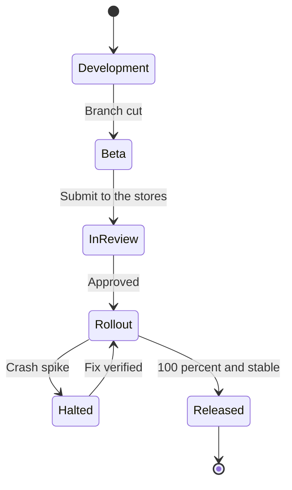

# Release process

Skiff ships once a month, named for the month: `2026.10` is the October release. Releases are boring on purpose. The same steps run every month, a person called the release manager owns them, and the only things that can delay a release are a failed checklist item or a crash-free rate below 99% in the beta.

::::wide
:::figure

Only the Halted state needs a person to decide something; every other transition is a step in the calendar.
:::
::::

## The monthly calendar

| Day | What happens |
| :-- | :----------- |
| First Monday | Branch cut from `main` to `release/YYYY.M`. Version numbers are set. Beta builds go to TestFlight and the Play internal track. |
| Monday to Thursday | Beta testing by the team and the 120 external testers. Only fixes for regressions are merged to the branch. |
| Friday | Release checklist reviewed. Submit to App Store review and to Google Play. |
| Following Tuesday | Approved builds start the staged rollout. |
| Following Tuesday to Monday | Rollout reaches 100% (see below). |

## Steps

1. **Cut the branch.** The release manager creates `release/2026.10` and bumps the version in `app.json`. `main` carries on towards the next release.
2. **Ship the beta.** CI builds both platforms and uploads them. The release manager posts the beta notes in `#skiff-releases`.
3. **Test.** The team works through the [Release checklist](doc:Release checklist). Regression fixes are cherry-picked from `main` with a reference to the issue.
4. **Submit.** On Friday, submit both builds. Write the release notes for the store listings, and make sure that anything that changes data collection is reflected in the privacy answers.
5. **Roll out.** When approved, start the staged rollout, in the stages below.
6. **Watch.** The mobile on-call engineer checks Sentry at each stage change. If crash-free sessions fall below 99%, follow [Crash spike after a release](doc:Crash spike after a release).

## Staged rollout

| Stage | Android | iOS | Gate to continue |
| :---- | :------ | :-- | :--------------- |
| 1 | 5% | Day 1 of phased release | Crash-free 99% or higher after 24 hours |
| 2 | 20% | Day 2 | Same, with at least 500 sessions |
| 3 | 50% | Day 4 | Same |
| 4 | 100% | Day 7 | Release is closed |

Apple's phased release is fixed at seven days and cannot be sped up except by releasing to everyone, which we do not do.

## Who does what

The release manager rotates monthly among the senior engineers. Jonas Weber is a backup and approves any change to the process. Marcus Lee is told if a release will slip by more than two working days.
