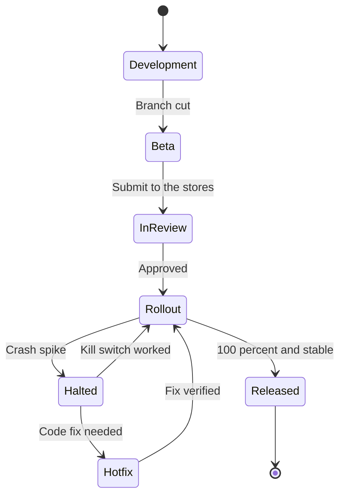

# Release process

Skiff ships once a month, named for the month: `2026.10` is the October release. Releases are boring on purpose. The same steps run every month, a person called the release manager owns them, and the only things that can delay a release are a failed checklist item or a crash-free rate below 99% in the beta.

:small[Status on 12 October 2026: 2026.10 was cut on 5 October, submitted on 9 October and is in store review.]

::::wide
:::figure

Only the Halted state needs a person to decide something; every other transition is a step in the calendar.
:::
::::

## The monthly calendar

| Day | What happens |
| :-- | :----------- |
| First Monday | Branch cut from `main` to `release/YYYY.M`. Version numbers are set. Beta builds go to TestFlight and the Play internal track. |
| Monday to Thursday | Beta testing by the team and the 120 external testers. Only fixes for regressions are merged to the branch. |
| Friday | Release checklist reviewed. Submit to App Store review and to Google Play. |
| Following Tuesday | Approved builds start the staged rollout. |
| Following Tuesday to Monday | Rollout reaches 100% (see below). |

## Steps

1. **Cut the branch.** The release manager creates `release/2026.10` and bumps the version in `app.json`. `main` carries on towards the next release.
2. **Ship the beta.** CI builds both platforms and uploads them. The release manager posts the beta notes in `#skiff-releases`.
3. **Test.** The team works through the [Release checklist](doc:Release checklist). Regression fixes are cherry-picked from `main` with a reference to the issue.
4. **Submit.** On Friday, submit both builds. Write the release notes for the store listings, and make sure that anything that changes data collection is reflected in the privacy answers.
5. **Roll out.** When approved, start the staged rollout, in the stages below.
6. **Watch.** The mobile on-call engineer checks Sentry at each stage change. If crash-free sessions fall below 99%, follow [Crash spike after a release](doc:Crash spike after a release).

## Staged rollout

| Stage | Android | iOS phased release | Gate to continue |
| :---- | :------ | :----------------- | :--------------- |
| 1 | 5% | Days 1 and 2 (1% then 2%) | Crash-free 99% or higher after 24 hours |
| 2 | 20% | Days 3 to 5 (5%, 10%, 20%) | Same, with at least 500 sessions |
| 3 | 50% | Day 6 | Same |
| 4 | 100% | Day 7 | Release is closed |

Apple's phased release follows a fixed seven-day schedule that we cannot change. It can only be paused, or ended early by releasing to everyone. We do the latter only for hotfixes.

## Hotfixes

A hotfix is a release in a hurry, so it has fewer steps and no fewer checks:

1. Branch `hotfix/2026.9.1` from the tag of the release that is live.
2. Make one change, with a test that fails without it. Two engineers review it.
3. Build and send to the Play internal track and to TestFlight. The team tests for at least two hours.
4. Submit with an expedited review request on iOS. Google Play is usually approved within hours.
5. Start Android at 20%. On iOS, once the build is approved, release to all users.
6. Merge the fix back to `main` the same day.

## Who does what

The release manager rotates monthly among the senior engineers. Jonas Weber approves any change to the process, and Marcus Lee is told if a release will slip by more than two working days.
