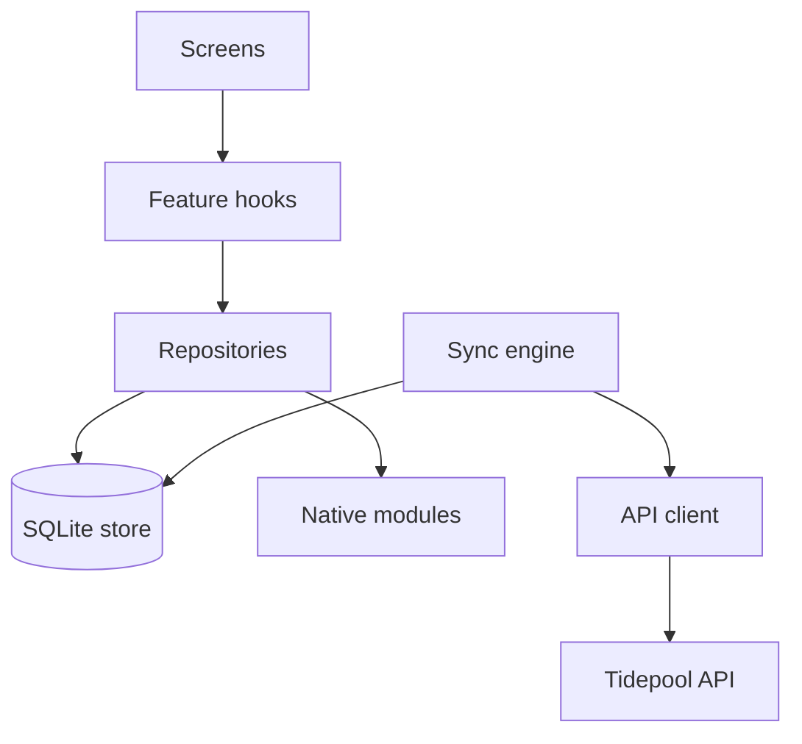

# Skiff app architecture

Skiff is the React Native companion to Tidepool: one TypeScript codebase for iOS and Android, used to capture feedback where the web app is awkward, such as a hospital ward, a shop floor or a train with no signal. Three requirements shape almost everything below. Capture must never fail because the network is down. A voice note must survive the app being killed mid-recording. Cold start must stay under 2.0 seconds on a four-year-old mid-range Android phone (our reference device is a Pixel 6a).

## The layers

::::wide
:::figure



Dependencies point downwards. Nothing above the repositories knows that a network exists.
:::
::::

| Layer | Responsibility | Built with |
| :---- | :------------- | :--------- |
| Screens | Rendering and gestures, no business rules | React Native (Fabric), React Navigation 7 native stack |
| Feature hooks | One hook per use case, such as `useCaptureNote` | React, Zustand for UI-only state |
| Repositories | Read and write local rows, expose live queries | op-sqlite, Kysely |
| Sync engine | Outbox, pull cursor, conflict rules | In-house; see [Offline sync design](doc:Offline sync design) |
| API client | Typed calls to Tidepool | Generated from the OpenAPI document with openapi-typescript |
| Native modules | Recording, secure storage, background upload | Swift and Kotlin, exposed as TurboModules |

The rule that keeps this honest is enforced by `eslint-plugin-boundaries`: a screen may import hooks, a hook may import repositories, and only the sync engine may import the API client.

## Navigation and state

Navigation is React Navigation's native stack with three tabs: Inbox, Capture and Settings. Server data is never held in a JavaScript cache. It lives in SQLite, and screens read it through live queries that re-run when a table changes. That gives one source of truth, and a screen renders the same thing online and offline.

> [!NOTE]
> We evaluated TanStack Query and dropped it. With SQLite as the source of truth it would have been a second cache that could disagree with the first.

Zustand holds only state that dies with the screen: a half-typed note, the selected filter, whether the recorder sheet is open. Anything that must survive a restart is a row.

### Following one quick note

A user taps Capture, types two lines and presses Save. `useCaptureNote` calls `notes.create()` on the note repository, which writes the `note` row and an `outbox` row in one SQLite transaction and returns in under 15 ms. The Inbox live query fires and the note appears with a small clock icon. Later, the sync engine sends the outbox row, the server assigns a version, and the clock disappears. If the user is in a lift for the next ten minutes, nothing in that story changes except "later".

## The new architecture

Since 2026.6 on iOS and 2026.7 on Android, Skiff runs on Fabric and TurboModules with the bridge disabled. The decision and its alternatives are in [RFC-012: Adopt the React Native new architecture](doc:RFC-012: Adopt the React Native new architecture). What it changed in practice:

- **Native modules are typed by a spec.** Each module has a TypeScript spec that codegen turns into the Swift and Kotlin interfaces, so a signature mismatch is a build error and no longer a runtime crash.
- **Synchronous reads are allowed, once.** The secure-storage module may answer synchronously during start-up. Everything else stays asynchronous: a synchronous call blocks the JS thread, and we have no budget for that.
- **Long lists got cheaper.** The Inbox with 2,000 notes dropped from 31 to 14 dropped frames over a standard scroll.

## Native modules

Two things cannot be done well in JavaScript: recording audio that survives backgrounding, and uploads that continue after the app is suspended. Both are native modules with the same small surface on each platform.

:::code-group
```ts [Spec]
import type { TurboModule } from 'react-native'
import { TurboModuleRegistry } from 'react-native'

export interface Spec extends TurboModule {
  start(noteId: string): Promise<string>
  stop(noteId: string): Promise<{ chunks: number; durationMs: number }>
}

export default TurboModuleRegistry.getEnforcing<Spec>('SkiffRecorder')
```
```swift [iOS]
@objc(SkiffRecorder)
final class SkiffRecorder: NSObject {
  private let engine = AVAudioEngine()

  @objc func start(_ noteId: String,
                   resolve: @escaping RCTPromiseResolveBlock,
                   reject: @escaping RCTPromiseRejectBlock) {
    do {
      try AVAudioSession.sharedInstance().setCategory(.record, mode: .default)
      try ChunkWriter.open(noteId: noteId, chunkSeconds: 10, engine: engine)
      try engine.start()
      resolve(noteId)
    } catch {
      reject("E_RECORDER_START", error.localizedDescription, error)
    }
  }
}
```
```kotlin [Android]
class SkiffRecorderModule(ctx: ReactApplicationContext) : NativeSkiffRecorderSpec(ctx) {
  override fun getName() = NAME

  override fun start(noteId: String, promise: Promise) {
    runCatching {
      RecorderService.start(reactApplicationContext, noteId, chunkSeconds = 10)
    }.onSuccess { promise.resolve(noteId) }
      .onFailure { promise.reject("E_RECORDER_START", it) }
  }

  companion object { const val NAME = "SkiffRecorder" }
}
```
:::

> [!WARNING]
> Audio is written to the app's documents directory in 10-second chunks, never held in memory. A killed app loses at most the last 10 seconds. See [Voice capture pipeline](doc:Voice capture pipeline) for what happens to the chunks next.

## Budgets

:::table[Budgets and the 2026.6 measurements]{width=70% caption=bottom}
| Metric | Budget | Measured |
| :----- | -----: | -------: |
| Cold start, Pixel 6a | 2.0 s | 1.5 s |
| Cold start, iPhone 12 | 1.2 s | 0.8 s |
| JS bundle (Hermes bytecode) | 6.0 MB | 5.4 MB |
| Android download size | 28 MB | 25.9 MB |
| Crash-free sessions, 30 days | 99.5% | 99.6% |
:::

Crash-free sessions is back above budget now that the long-recording out-of-memory crash is fixed. The bundle grew by 0.2 MB because codegen output is checked in.

## Errors and telemetry

Unhandled errors and promise rejections go to Sentry. Breadcrumbs never contain note text, transcripts or tag names: Harbourview Health's security review required that no patient-adjacent content leaves the device through telemetry. If crash-free sessions drops below 99% after a release, follow [Crash spike after a release](doc:Crash spike after a release).

## What we deliberately do not do

- **No over-the-air JavaScript updates.** Harbourview Health's device policy requires every code change to pass app store review, and we do not want two release paths.
- **No shared UI kit with the web app.** The design tokens are shared; components are not. Touch targets, sheets and gestures differ enough that sharing cost more than it saved in the prototype.
- **No background polling loop of our own.** The sync engine runs when the app is foregrounded, after a write, and on the operating system's background schedule.
