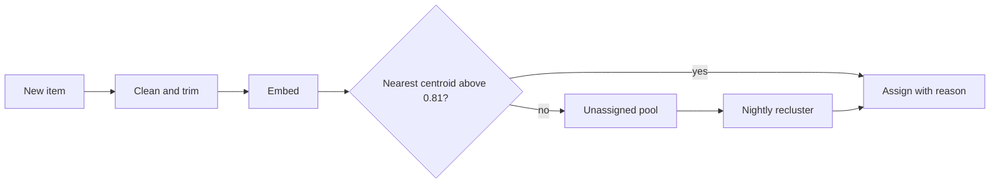

# Spec: Feedback clustering v2

::toc{min=2 max=2}

## Summary

Clustering today assigns each piece of feedback to a theme by keyword overlap. In our audit of 1,200 labelled items from six customers, about one item in five landed in the wrong theme, and the product cannot say why it chose the one it did. This spec replaces keyword matching with embedding-based assignment that records its reasons.

**Owner:** Marcus Lee. **Reviewers:** Priya Nair, Aisha Khan, Jonas Weber (for the Skiff voice-note path). The product case is in [Product vision 2027](doc:Product vision 2027). Q1 sizing is in [Q1 2027 themes and bets](doc:Q1 2027 themes and bets).

## Goals and non-goals

- At least 95% of labelled items are grouped the way a person would group them.
- Every assignment stores a reason a customer can read: the nearest evidence items and the phrases they share.
- A new item is assigned in under 400 ms at the 95th percentile, so a voice note or widget submission shows its theme almost immediately.
- Existing themes, their names and their merge history survive the migration unchanged.

Not goals: training a model per customer, learning across workspaces, or redesigning the theme screens beyond showing reasons.

## How assignment works

::::wide
:::figure



An item joins a theme at once if it is close enough; otherwise it waits for the nightly recluster, which may also create a theme.
:::
::::

The embedding model returns 768 dimensions. A theme's centroid is the mean of its member embeddings, recomputed whenever a theme gains or loses more than 5% of its items. The similarity threshold is 0.81 cosine similarity, chosen from the first prototype run.

## Where vectors live

:::table[Storage options]{width=70% caption=bottom}
| Option | Extra infrastructure | p95 nearest-centroid query | Decision |
| :----- | :------------------- | -------------------------: | :------- |
| pgvector in PostgreSQL | None | 38 ms | Chosen |
| Dedicated vector store | New cluster per region | 21 ms | Rejected |
| Redis vector search | None, but memory-bound | 12 ms | Rejected |
:::

We choose pgvector. The 17 ms we give up is irrelevant against a 400 ms budget, and a separate store would double the failover work described in the platform runbooks. Centroids are small (one row per theme), so queries hit an index on `theme_centroid` and never scan items.

## Data model

```sql
alter table feedback_item add column embedding vector(768);

create table theme_centroid (
  theme_id    uuid primary key references theme (id),
  workspace_id uuid not null,
  centroid    vector(768) not null,
  member_count integer not null,
  updated_at  timestamptz not null default now()
);

create index on theme_centroid using hnsw (centroid vector_cosine_ops);
```

Reasons are stored with each assignment, not recomputed, so a customer sees the same explanation tomorrow that they saw today.

```ts title="packages/clustering/src/assignment.ts"
export interface AssignmentReason {
  readonly similarity: number
  readonly evidence: readonly { itemId: string; similarity: number }[]
  readonly sharedPhrases: readonly string[]
}
```

## What customers see

Each item in a theme gets a one-line reason: "Similar to 3 items about exporting to PDF (82%)". Opening it shows the nearest evidence items side by side and the phrases they share. A reviewer can move the item, and the move is recorded as a correction. Corrections are not used for training in this release, but we keep them: they will become the next labelled set.

Themes also show a confidence band (high, medium, low) based on how tightly their members sit around the centroid. Low-confidence themes are the first thing a reviewer should merge or split.

## Evaluation

:::table[Measures on the labelled set]{width=70% caption=bottom}
| Measure | Today | Prototype | Target |
| :------ | ----: | --------: | -----: |
| Items grouped as a person would | 80% | 93% | 95% |
| Themes a reviewer calls coherent | 71% | 88% | 90% |
| p95 assignment latency | 2.1 s | 0.31 s | 0.4 s |
:::

The labelled set now has 1,560 items, including 360 German and French items from Northwind Retail. The prototype misses the target by two points, almost all of it in short items (under six words) such as "needs dark mode". We will test prepending the source and product area to short items before embedding.

## Backfill and rollout

About 480 million existing items need embeddings. At 4,000 items per second per region that is roughly 33 hours of compute. We backfill oldest-last, so recent items are embedded first, and keep keyword clustering running until a workspace's backfill completes.

> [!IMPORTANT]
> Embeddings are stored in the same region as the workspace's items. Nothing leaves `us-east-1` or `eu-west-1` for embedding, which matters to Harbourview Health and Pinecrest Bank.

Enable per workspace behind the `clustering-v2` flag: internal workspaces first, then Oakline Studios and Lantern Logistics, then everyone.

## Work

- [x] Evaluate three embedding models on the labelled set
- [x] Add the pgvector extension to staging in both regions
- [x] Write the reason format and its schema version
- [ ] Build the backfill job with resumable batches
- [x] Add German and French items to the labelled set
- [ ] Design the reasons panel with Sofia
- [ ] Test source-prefixed short items

## Alternatives considered

::::accordion{name=alternatives}
:::details[Ask a language model to label every item]
Accurate on short items and easy to explain, but at roughly 20 times the embedding cost and 1.5 seconds of latency per item, with no stable theme identity between runs. Rejected for assignment; we may use one to name themes later.
:::
:::details[Tune the keyword model]
We spent two weeks in August on synonyms and stemming. It moved accuracy from 78% to 80% and made the reasons harder to read, not easier.
:::
:::details[Per-customer fine-tuning]
Promising for the largest accounts, but it multiplies storage and operational work by the number of customers. Revisit in 2028 if the labelled-set gap persists.
:::
::::

## Risks

- **Model changes.** Replacing the embedding model invalidates every vector. We store the model version beside each embedding and can re-embed lazily.
- **Cost.** At the current price, embedding 41 million new items a month costs about $410. Backfill is a one-off of roughly $4,800.
- **Reasons that mislead.** A shared phrase is not always the cause. The panel says "similar to" and never "because".
