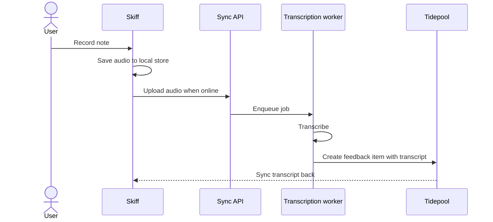

# Spec: Skiff voice notes

## Problem

Field teams do not type. At Northwind Retail, store managers told us they have time to "say a sentence", not write one (see [Interview notes: Northwind Retail](doc:Interview notes: Northwind Retail)). Skiff captures text notes today. This spec adds voice notes that become transcripts and enter Tidepool as ordinary feedback.

## What the user does

1. Hold the microphone button in Skiff, or tap it once to start and again to stop.
2. The note is saved on the phone immediately, with a waveform and a "waiting to upload" marker if there is no signal.
3. When the phone is online, the audio uploads, is transcribed, and the transcript appears in the note within about two minutes.
4. The transcript is editable. Editing it never changes the stored audio.

## Flow

::::wide
:::figure

The phone never waits for the transcript; it learns about it on the next sync.
:::
::::

## Limits

:::table[Launch limits]{width=70% caption=bottom}
| Limit | Value | Reason |
| :---- | ----: | :----- |
| Maximum recording | 5 min | Lantern Logistics drivers dictate whole delivery reports |
| Audio format | AAC, 32 kbps | Good enough for speech |
| Audio retention | 30 days | Transcript is the record |
| Languages | 4 | English, German, Dutch, French |
| Target transcription time | 2 min | From upload to transcript |
:::

A five-minute note is about 1.2 MB, so uploads use the background transfer service and resume after a dropped connection. The queue and local store behaviour are described in [Voice capture pipeline](doc:Voice capture pipeline).

## Decisions

- **Transcription runs on the server.** On-device models handled English well but made too many errors in Dutch and German in Jonas's tests (word error rate 19% against 8%). We revisit when that gap closes.
- **The audio is deleted after 30 days**, whether or not the transcript was edited. Customers who need audio for compliance can ask for 90 days on a workspace; see the open question below.

## Open questions

- Which vendor? We have a quote from one and will test a self-hosted model.
- Do we keep audio longer for customers who ask? Harbourview Health would want 90 days for clinician notes.
