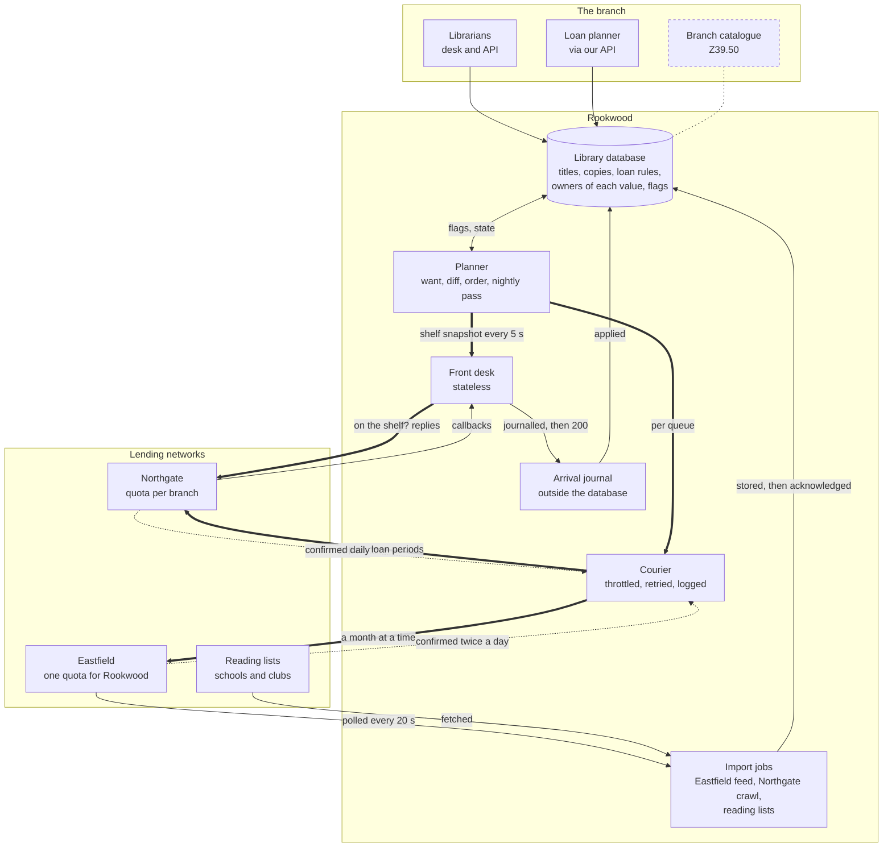
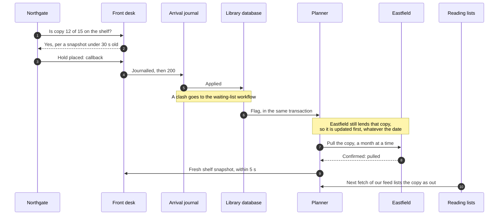
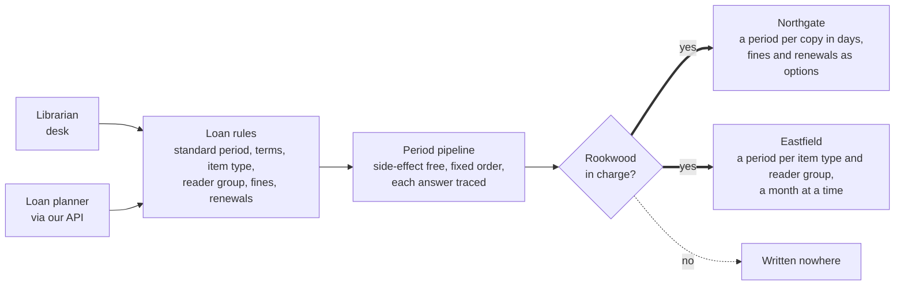
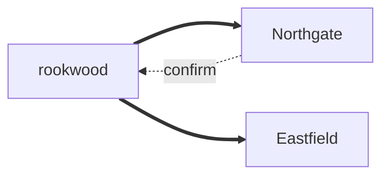
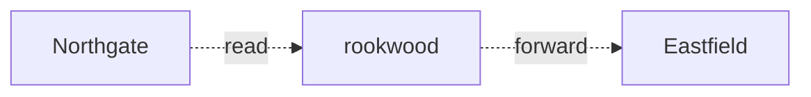
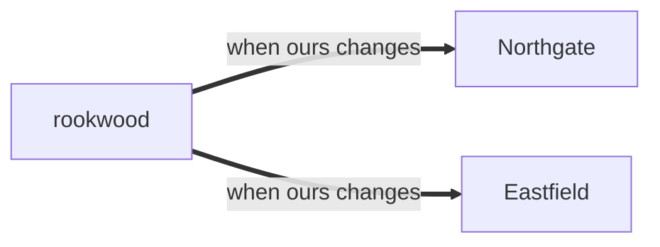
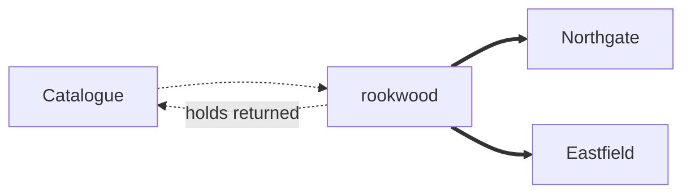

Architecture

# Rookwood Catalogue Map

How copies, shelf status, holds and loan periods travel between the Rookwood library service, the Northgate and Eastfield lending networks, school reading lists and a branch's own catalogue. Which arrows exist depends on who is in charge of each value.

:small[Drawn from the code on 11 October 2026. Heavy lines leave Rookwood, light lines arrive, dashed lines confirm a write, and grey dotted lines are planned rather than running.]

## The cycle

Every arrival is written to the library database first. A planner then decides what each network ought to show, sets that beside what it last wrote and last read, and writes only what differs. Flags speed it up; the nightly pass keeps it honest.

::::wide
:::figure

Northgate's callbacks reach the front desk, which also answers its "is a copy on the shelf?" question from a snapshot refreshed every five seconds; once that snapshot is half a minute stale, the desk says no (ADR 0026). The import jobs make their own calls through the courier, drawn separately here only to keep the picture tidy. Throw away every flag and queue and the nightly pass would still find all the work.

:::
::::

## One hold, followed through

A hold placed through Northgate, in order. No step waits on a push. Eastfield is updated before anything else, since the planner's record shows it still lending a copy that has just gone (ADR 0042). Had the flag been lost, the nightly pass would reach the same conclusion.

::::wide
:::figure

Eastfield's holds arrive another way: Rookwood polls its feed every twenty seconds, stores what it finds and only afterwards acknowledges it (ADR 0040). Left unacknowledged for half an hour, Eastfield falls back to emailing the branch. From step 5 onward the path is shared by every source. Reading lists fetch on a timetable of their own and so trail every other network.

:::
::::

## Loan periods stay rules until asked for

Nothing stores a table of finished loan periods. The rules are stored and worked through when a network needs an answer. Each slice carries a fingerprint of its inputs, so an untouched rule, hold or setting means no work and no write.

::::wide
:::figure

Where a network or nobody is in charge of a loan period, Rookwood writes it nowhere for now: periods are not yet read back from the networks, and writing ours would leave two answers to one question (ADR 0075). Eastfield could derive periods on its side; the option is declared but switched off.

:::
::::

## The owner of a value decides the arrows

Every field names who is in charge of it: Rookwood, a network, both, or the branch's own catalogue. The choice sits on the most specific level that needs one and flows down from the library. The four patterns below cover shelf status, lending rules, loan periods and catalogue records equally. Holds are always read from every network, whatever the owner.

::::wide
:::cards

### Rookwood is in charge

Written to each network. An edit made inside a network is spotted on the next confirmation and reverted.

### A network is in charge

For now nothing is written and each network keeps its own. Planned: read from the owner and forwarded to the rest.

### Both are in charge

Written only after our own value moves, so a librarian's edit inside a network survives until then. Reconciling edits made on both sides is planned (plan section 6).

### The branch catalogue is in charge

Planned (ADR 0035): the branch catalogue reports shelf status and loan periods over Z39.50, Rookwood forwards them, and holds flow back.

:::
::::

## An owner for each kind of record

One setting per kind of record decides it: `OwnerRule` in `@rookwood/policy`. Single fields may override it, and it flows library → region → branch, remembering at which level each answer was chosen. With nothing chosen, Rookwood is in charge. An edit to a value owned elsewhere is rejected by the API with `409` and an explanation. At present the planner consults the owner only for loan periods and lending rules.

:::wide

| Kind of record | Possible owners | Planner respects the owner |
| --- | --- | --- |
| Catalogue records | Rookwood, a network, both; field by field ("Northgate owns the summary") | :badge[Not yet] No writes yet, so nothing is replaced. |
| Cover images | Rookwood, a network, both | :badge[Not yet] No writes yet. |
| Shelf status | Rookwood; the branch catalogue (planned) | :badge[Not read]{tone=warning} Treated as Rookwood's in every case. A copy listed elsewhere stays off the other shelves. |
| Loan periods | Rookwood, a network, both, nobody | :badge[Yes]{tone=success} Owned elsewhere: written nowhere (ADR 0075). |
| Fine options | Late fees and renewal caps, each separately | :badge[Yes]{tone=success} Only the options Rookwood owns are written. |
| Lending rules | Rookwood, a network, both, nobody | :badge[Yes]{tone=success} A rule owned elsewhere is skipped (ADR 0041). |
| Holds | No owner: a hold is a fact, wherever it was placed | :badge[Always in]{tone=success} Read from every network, including paused and switched-off ones (ADR 0040). |

:::

## Each network in turn

What travels each way at present, how often it is confirmed, and what remains to be built.

:::wide

| Network | Records and covers | Shelf status | Holds | Loan periods and lending rules |
| --- | --- | --- | --- | --- |
| Northgate | :badge[Designed] `out` Summaries, subjects and notes; a cover per request. Confirmed weekly. | :badge[Built]{tone=success} `out` Shelf changes, which Northgate applies inside a quarter of an hour. Confirmed daily, which is how a librarian's own edit comes to light. | :badge[Built]{tone=success} `in` Callbacks to the front desk, a crawl of each title, and a full comparison four times a day. | :badge[Built]{tone=success} `out` Periods in whole days; late fees and renewal caps as title options; lending rules per copy. Confirmed daily. |
| Eastfield | :badge[Designed] `out` Structured JSON records. Covers are uploaded in batches that publish later, so they are checked before replacement. | :badge[Built]{tone=success} `out` A branch and a month per request. Confirmed twice a day, 31 copies per read. | :badge[Built]{tone=success} :badge[No reconciliation]{tone=warning} `in` Feed polled every 20 seconds, acknowledged once stored. There is no list of holds to compare with. | :badge[Built]{tone=success} `out` A table by item type and reader group; lending rules per copy. Confirmed daily. |
| Reading lists | Not exchanged. | :badge[Built]{tone=success} `out` Our feed, fetched on their timetable. The last to catch up. | :badge[Built]{tone=success} `in` Their lists count as holds: copies reserved, no reader details. | Not exchanged. |
| Branch catalogue | :badge[Designed] `in` When it owns them. | :badge[Designed] `in` Z39.50, each change as it happens and a full resend now and then. | :badge[Designed] `out` Every hold from every network, queued until the catalogue confirms it. | :badge[Designed] `in` Z39.50, then forwarded to the networks. |

:::

## Why it stays correct

::::wide
:::cards{variant=ruled}

### Acknowledged means kept

A callback gets its 200 only after the arrival journal has it; a polled Eastfield hold is acknowledged only after the database has it.

### Work is recomputed, not just queued

Pending work is any slice whose wanted state disagrees with what was last written or read. A lost queue delays the work but never drops it.

### No write without a change

Inputs are fingerprinted, so a slice nobody touched costs one comparison and no request.

### One slice, one request

Slices are sized to each network's limits, so no write can land halfway.

:::
::::
