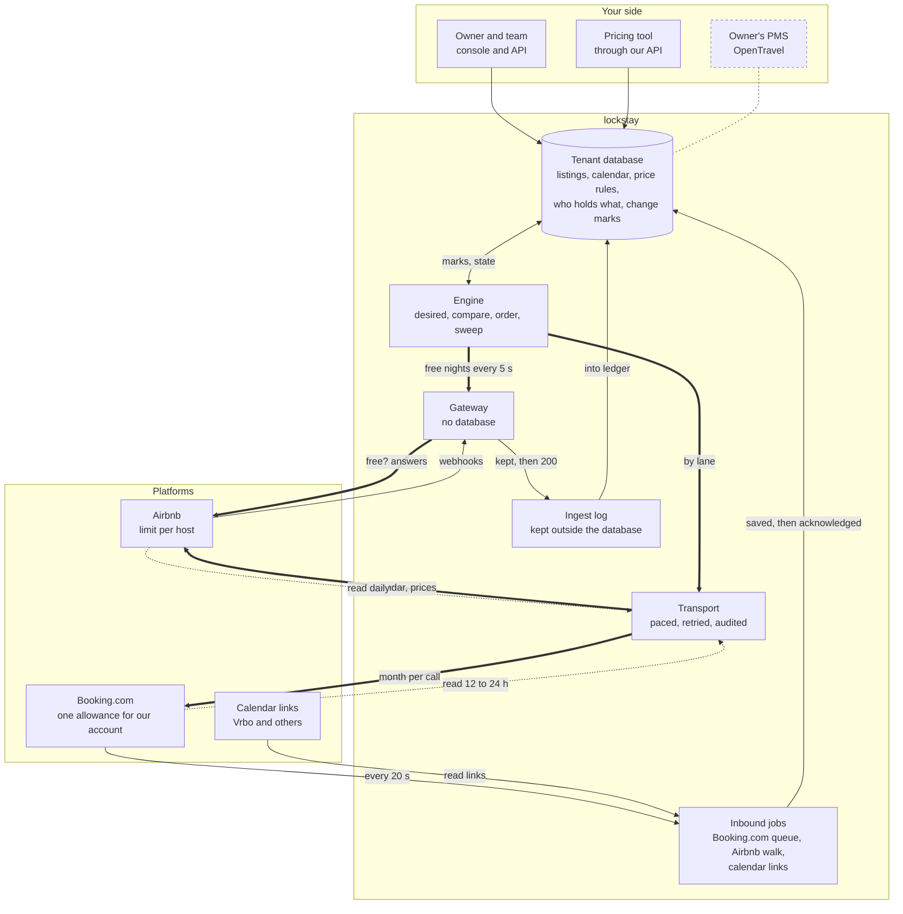
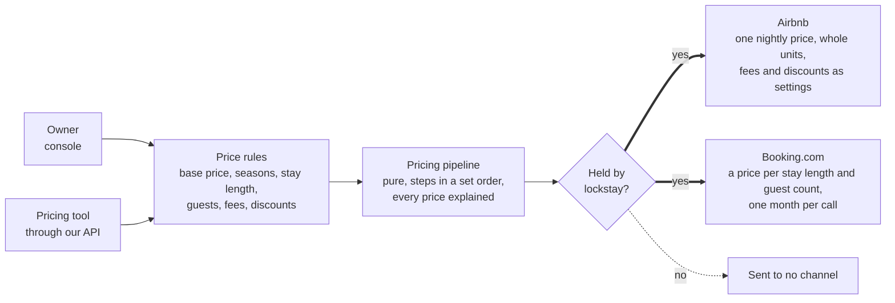
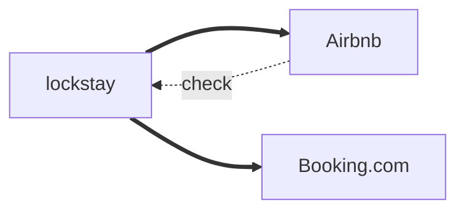
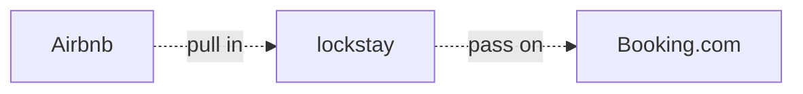
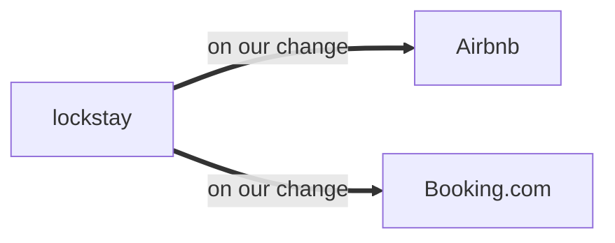
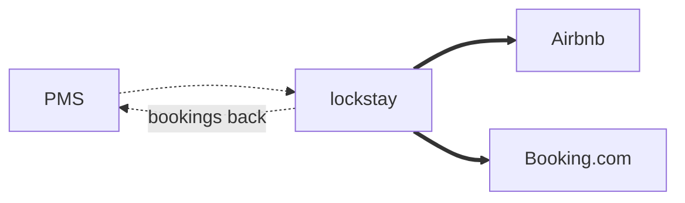

Architecture

# lockstay Sync Map

How properties, availability, bookings and prices move between lockstay and Airbnb, Booking.com, calendar links and an owner's PMS. It also shows how the flow changes with who holds each value.

:small[Drawn from the code and the ADRs on main, 11 October 2026. Thick lines are what we send, thin lines what comes in, and dashed lines read back to check; dotted grey lines are designed but not built.]

## The loop

Facts come in on the bottom path and become rows in the tenant database. The engine works out what each channel should hold, compares that with what it last sent and saw, and sends the difference on the top path. Marks make it prompt; the sweep makes it correct.

::::wide
:::figure



The gateway takes Airbnb's webhooks and answers Airbnb's "are these nights free?" from a snapshot the worker publishes every 5 seconds. It fails closed once the snapshot is 30 seconds old (ADR 0026). The inbound jobs also call out through the transport; they are drawn apart to keep the lines straight. Delete every mark and queue, and the sweep still finds every difference.

:::
::::

## A booking closes its nights everywhere

An Airbnb booking, step by step. Nothing here pushes on an event. The closure goes first because the slice's own record says Booking.com is offering a night that is no longer free (ADR 0042). A sweep after a lost mark finds the same thing.

::::wide
:::figure

```mermaid
sequenceDiagram
  accTitle: A booking closes its nights everywhere
  accDescr: An Airbnb booking arrives as a webhook, is logged, taken into the ledger and marked; the engine closes the nights on Booking.com first, reads the closure back, and publishes new free nights for the gateway.
  autonumber
  participant airbnb as Airbnb
  participant gateway as Gateway
  participant ingest as Ingest log
  participant db as Tenant database
  participant engine as Engine
  participant booking as Booking.com
  participant links as Calendar links

  airbnb->>gateway: Are 12 to 15 March free?
  gateway-->>airbnb: Free, from a snapshot under 30 s old
  airbnb->>gateway: Booked: webhook
  gateway->>ingest: Appended, then 200
  ingest->>db: Taken into the ledger
  Note over ingest,db: An overlap is refused: double-booking workflow
  db->>engine: Mark, same transaction
  Note over engine,booking: Booking.com still offers those nights,<br>so it goes first, at any date
  engine->>booking: Closure, one month per call
  booking-->>engine: Read back: closed, confirmed
  engine->>gateway: New free nights for the gateway, within 5 s
  links->>engine: Their next read of our feed shows the nights busy
```

A Booking.com booking takes the other road in. It is pulled from Booking.com's queue every 20 seconds, saved to the ledger, and only then acknowledged (ADR 0040). After 30 minutes without an acknowledgement, Booking.com emails the property instead. Steps 5 to 9 are the same for every source. Calendar links are read on their own schedule, so they are the slowest channel to close.

:::
::::

## Prices are rules until a channel needs them

No price matrix is stored. Rules are kept and evaluated on demand. A slice is fingerprinted by its inputs, so if no rule, booking or setting moved, nothing is computed and nothing is sent.

::::wide
:::figure



A nightly price held by a platform or by nobody is sent to no channel today. Nothing imports a platform's prices yet, so sending ours would create a second source of truth (ADR 0075). Booking.com can expand derived rates itself; that is in the manifest but not yet used.

:::
::::

## Who holds the value changes the arrows

Each field has a holder: lockstay, a platform, both, or the owner's own system. It is set at the narrowest level that needs it and inherited from the account down. The four shapes below apply to availability, stay rules, prices and listing details alike. Bookings always come in from every channel, whoever holds what.

::::wide
:::cards

### lockstay holds it



Sent to every channel. A change made on a platform is found by the next check and put back.

### A platform holds it



Today: sent to no channel, and each keeps what it has. Designed: pulled in from the holder and passed to the others.

### Both hold it



Sent only when our value changes. A host's own edit on the platform stands until then. Settling an edit made on both sides is designed (plan section 6).

### The owner's PMS holds it



Designed (ADR 0035): the PMS sends availability and prices over OpenTravel, we send them on, and bookings go back to it.

:::
::::

## One holder per class of data

The control is one rule per class: `AuthorityRule` in `@lockstay/policy`. A field can narrow it, and it is inherited account → group → property, with where it was set kept for every answer. When nothing is set, lockstay holds it. The API refuses an edit to a value another system holds with `409` and the reason. Today the engine reads the holder for prices and stay rules only.

:::wide

| Class of data | Holders it can have | Engine honours the holder |
| --- | --- | --- |
| Listing details | lockstay, a platform, both; per field ("Airbnb holds the description") | :badge[Not yet] Nothing is sent yet, so nothing is overwritten. |
| Photos | lockstay, a platform, both | :badge[Not yet] Nothing is sent yet. |
| Availability | lockstay; the owner's PMS (designed) | :badge[Not read]{tone=warning} Always treated as lockstay's. A night another site's calendar holds is kept closed on the others. |
| Nightly prices | lockstay, a platform, both, nobody | :badge[Yes]{tone=success} Held elsewhere: sent to no channel (ADR 0075). |
| Pricing settings | Guest fee and stay-length discounts, each on its own | :badge[Yes]{tone=success} Only the settings lockstay holds are written. |
| Stay rules | lockstay, a platform, both, nobody | :badge[Yes]{tone=success} A rule held elsewhere is left out of the write (ADR 0041). |
| Bookings | Not a setting: a fact from wherever it was made | :badge[Always in]{tone=success} Taken in from every channel, paused and disabled ones included (ADR 0040). |

:::

## Platform by platform

What moves in each direction today, how often it is checked, and what is still to build.

:::wide

| Platform | Listing details and photos | Availability | Bookings | Prices and stay rules |
| --- | --- | --- | --- | --- |
| Airbnb | :badge[Designed] `out` Text, amenities and policies; one photo per call. Checked weekly. | :badge[Built]{tone=success} `out` Calendar operations, applied by Airbnb within about 15 minutes. Read back daily, the only way to find a host's own edit. | :badge[Built]{tone=success} `in` Webhooks to the gateway, a page walk of each listing, and a full reconciliation every 6 hours. | :badge[Built]{tone=success} `out` Nightly price in whole units; guest fee and stay-length discounts as listing settings; stay rules per night. Read back daily. |
| Booking.com | :badge[Designed] `out` Modular JSON content. Photos upload in batches that go live later, so they are read before any replace. | :badge[Built]{tone=success} `out` One property and one month per call. Read back every 12 hours, 31 nights a read. | :badge[Built]{tone=success} :badge[No reconciliation]{tone=warning} `in` Queue pulled every 20 seconds, acknowledged after saving. No list of bookings to check against. | :badge[Built]{tone=success} `out` A grid by stay length and guest count; stay rules per night. Read back daily. |
| Calendar links | Not carried. | :badge[Built]{tone=success} `out` Our feed, read on their schedule. Slowest to close. | :badge[Built]{tone=success} `in` Their links read as holds: nights taken, no guest details. | Not carried. |
| Owner's PMS | :badge[Designed] `in` When it holds them. | :badge[Designed] `in` OpenTravel, changes as they happen plus a periodic full resend. | :badge[Designed] `out` Every booking from every channel, queued until the PMS confirms it. | :badge[Designed] `in` OpenTravel; then sent on to the channels. |

:::

## What holds it together

::::wide
:::cards{variant=ruled}

### Nothing acknowledged is lost

A webhook is answered only once it is in the ingest log; a queued Booking.com booking is acknowledged only once it is in the ledger.

### Work is derived, never only queued

Outstanding work is every slice whose wanted state differs from what was sent or seen. Losing a queue costs time, not correctness.

### Nothing sent that changes nothing

Fingerprints are taken of the inputs, so an unchanged slice costs one comparison and no call.

### A slice fits one call

Slices are cut to each platform's limits, so a send can never half-apply.

:::
::::
